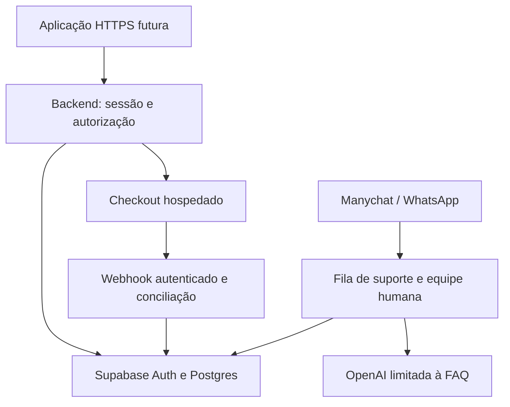

# Sprint 3 — arquitetura de assinantes reais

02/11/2026. Branch exclusiva `dev/navegacao-leo-familias-20261031`. Complementa os documentos comerciais dos commits `0f54042` e `64473dc`. Tudo abaixo é proposta, exceto a referência local explicitamente identificada. Nenhuma conta, credencial, integração ou infraestrutura foi criada.

## Recomendação e alternativas

Recomendo Supabase Auth + Postgres gerenciado, um backend próprio pequeno (BFF) e checkout hospedado Asaas para o primeiro sandbox, condicionado à confirmação de taxas/elegibilidade e testes de recorrência. Stripe é a alternativa com integração de assinatura/portal consolidada; Mercado Pago é alternativa brasileira a cotar. Não escolher provedor apenas pela taxa: incluir cancelamento, conciliação, prazo de recebimento e suporte.

| Opção de identidade/dados | Vantagens | Custos e cuidados |
|---|---|---|
| Supabase Auth + Postgres | Identidade gerenciada e modelo relacional; RLS como defesa adicional | Free para laboratório; Pro a partir de US$ 25/mês para primeiro projeto/compute básico; SMTP de produção separado |
| Firebase Auth + Firestore | Identidade gerenciada, SDK e camada gratuita | Modelo documental exige desnormalização e regras próprias; cobrança por operações; backend/recursos fora do Spark podem exigir Blaze |
| Auth próprio + Postgres | Controle amplo e menor dependência de Auth SaaS | Não recomendado para este MVP: recuperação de senha, sessões, abuso, auditoria e operação aumentam responsabilidade e manutenção |

Custos e fontes: [comparativo e orçamento](SPRINT-3-CUSTOS-E-PAGAMENTOS.md). Proposta de backend: Node com versão LTS a fixar na implementação, servindo a futura aplicação e `/api` na mesma origem HTTPS, hospedado em serviço gerenciado pequeno (referência de custo: Render). Manter o site oficial intacto; domínio e ambiente novos dependem de autorização. Isso evita depender de cookies de terceiros entre GitHub Pages e API. Não há migração do frontend nem novo servidor nesta entrega.

O Professor Leo/Worker atual fica preservado, separado de cobrança e suporte. Sua proteção comercial futura precisa de projeto próprio: apenas bloquear a aula não protege um endpoint de IA público por origem. Sem alterar o Worker, não se afirma que o tutor já está restrito a assinantes. Um futuro gateway de IA exigirá autorização e política para evitar contornar o backend; o MVP não deve prometer limite de acesso que hoje não aplica.

## Cadastro, login e recuperação

Supabase Auth para e-mail/senha com confirmação obrigatória. Não armazenar hashes/senhas em tabelas do Decola nem logs. Proposta: senha longa com suporte a gerenciadores, colagem permitida; MFA obrigatória para equipe administrativa e disponível ao assinante. Não usar SMS pago no piloto. Autorização de um responsável não concede leitura automática das conversas do estudante.

BFF troca credenciais com Auth por HTTPS, mantém tokens do provedor em armazenamento de sessão protegido no servidor e entrega cookie de sessão opaco `HttpOnly; Secure; SameSite=Lax; Path=/`, preferencialmente prefixo `__Host-`. Sessão curta de acesso, renovação rotativa, inatividade e prazo absoluto a definir (proposta: 30 minutos/7 dias); logout revoga a sessão do BFF e tokens de renovação. Invalidar sessões após redefinição de senha e mudança de permissões. Verificar estado da conta a cada operação sensível, não confiar somente em JWT ainda válido.

Recuperação responde genericamente independentemente de existir conta; limite por conta/IP com cautela em escolas/redes compartilhadas; link expira, é de uso único e aceita somente redirects exatos aprovados. Confirmar token pelo Auth antes de permitir redefinição; não fazer login privilegiado por query string. Testar scanners de e-mail, links usados/expirados, troca de conta e renovação. Selecionar SMTP transacional e domínio autenticado antes de usuários reais: o SMTP padrão do Supabase não é canal de produção.

BFF valida sessão no servidor; se usar JWT, verificar assinatura/JWKS, algoritmo permitido, emissor, audiência, validade e rotação, sem confiar em `user_metadata` para papéis ou assinatura. Mutações exigem CSRF token vinculado à sessão e validação de Origin/Host; SameSite é defesa adicional. Configurar limites, corpo máximo, mensagens genéricas e CSP, evitar HTML de entrada, não logar links de recuperação. São requisitos futuros, não controles já implantados.

## Banco e autorização

| Entidade | Identidade/índices e regra |
|---|---|
| accounts | ID do Auth, verificação, estado; e-mail gerido pelo Auth, não chave de autorização fornecida pelo cliente |
| students / guardian_links | Estudante separado do pagador; vínculo convidado/confirmado/revogado com escopos explícitos |
| plans / enrollments | Produto versionado; preço 3990 centavos BRL no servidor; matrícula única por aluno/produto |
| trial_claims | UNIQUE(chave de elegibilidade, produto); UTC e prazo imutáveis; conceder em transação |
| subscriptions / paid_periods | IDs externos únicos por provedor/ambiente, pagador e aluno; intervalos confirmados, cancelamento e revogação |
| payment_events | UNIQUE(provedor, ambiente, event_id), digest, status de processamento e referência segura; sem cartão |
| lesson_progress / attempts | aluno, lesson/question ID estável, versão do conteúdo, revisão otimista; histórico e estado atual separados |
| memory_assessments / mocks | versões das rubricas, respostas, tipo de avaliação e origem; não derivar acerto pela confiança no cliente |
| imports | UNIQUE(aluno, request_id), digest e resumo; origem local não verificada |
| support_tickets/messages/events | protocolo após persistência, autor/contato restrito, estado, responsável e auditoria |
| sessions / outbox | revogação, expiração; jobs idempotentes, retentativas limitadas e fila de falhas |

Modelo local em `infrastructure/subscribers/schema.sql` cobre um subconjunto em SQLite. Não é uma migration Supabase, nem usa RLS. Futuro Postgres usa UUID, timestamptz e intervalos, FKs, checks e transações/locks equivalentes; índices por aluno/produto, vencimento, status de fila e evento externo. Papéis separados para migração, aplicação, conciliação e atendimento. Revogar grants públicos por padrão, habilitar RLS em todas as tabelas expostas, testar políticas com identidades reais de teste; chaves `service_role` contornam RLS e nunca entram no cliente. Preferir consultas com contexto do usuário/papel limitado, sem usar superusuário como solução para autorização.

### Regras de acesso por operação

| Recurso | Política no servidor |
|---|---|
| Aula paga/MP3 privado/IA comercial futura | Sessão válida + conta ativa + vínculo autorizado + trial ou período pago válido |
| Progresso próprio, exportação e conta | Sessão e propriedade; continuam acessíveis mesmo com trial expirado |
| Checkout/cancelamento | Pagador autenticado e vínculo confirmado; aluno não altera cobrança alheia |
| Suporte | Conta própria, ou contato ainda não autenticado em fila limitada sem divulgar dados de conta |
| Equipe | MFA, função e escopo; acesso excepcional auditado, sem privilégio comercial dado pelo bot |

Aulas atuais compiladas e `demonstracao.html` são públicas. Somente novos conteúdos retirados dos bundles públicos e servidos por backend/private storage poderão ser comercialmente protegidos. Downloads usam URLs assinadas curtas e expiração; conteúdo entregue a um navegador não tem proteção absoluta contra cópia. Não bloquear exportação/conta/suporte quando assinatura vence. CORS não é autenticação, e esconder botão não é autorização.

## Sete dias gratuitos e assinatura

Proposta a aprovar: teste sem cartão, sem assinatura no provedor e sem conversão automática. Inicia por ação explícita após verificação. Tempo do servidor em UTC: `starts_at <= now < starts_at + 604800 segundos`. Horários da interface são apresentação; cron não decide acesso, cada requisição valida intervalo. Repetir requisição devolve a concessão existente, sem estender. Cancelar teste encerra acesso de teste imediatamente e conserva progresso; não concede novo teste nem cancela período pago independente.

Após expirar, permitir acesso à conta/progresso/suporte e oferecer contratação explícita. Para assinatura paga, cada ciclo é mês do calendário do provedor, não 30 dias fixos. Só período efetivamente confirmado concede acesso. Na primeira adesão paga, encerrar a concessão de trial remanescente na mesma transação de negócio para impedir que um reembolso/revogação volte a liberar acesso por um teste anterior; esse adaptador ainda não existe. Cancelamento normal interrompe renovação e mantém período já pago até o fim; reembolso/chargeback/revogação podem encerrar antes conforme política aprovada. Nenhuma dessas ações foi conectada ou executada.

Prevenção proporcional de abuso: concessão única por aluno/produto, vínculo de identidade verificada e chave de elegibilidade derivada no servidor; limitação de frequência e análise de repetição. Proposta de chave: HMAC de identidade normalizada com segredo separado/versionado; hash simples de e-mail não protege contra enumeração. Não aplicar normalização específica de Gmail indiscriminadamente. Ao recriar aluno/conta, a concessão anterior não reinicia, conforme retenção mínima aprovada. Troca de e-mail deve manter vínculo anterior e avaliação de risco; chaves de uma mesma identidade precisam de política de rotação.

Isso não impede alguém de obter outros e-mails. IP, aparelho ou telefone compartilhado não provam fraude; usar somente sinais com revisão humana e canal de contestação. Não exigir CPF/biometria ou fingerprint invasivo para experimentar sem decisão específica. Definir retenção da chave antifraude e exclusão com revisão de privacidade, sem declarar conformidade automática.

## Integração de pagamento futura

Criar checkout no backend usando preço/ciclo de catálogo; não aceitar valor, cliente, aluno ou estado pago do navegador como fonte de verdade. Persistir vínculo checkout/pagador/aluno antes do redirect. Aceitar renovação somente de evento autenticado e conciliado ao pagamento canônico do provedor, verificando conta recebedora, ambiente, moeda, valor, cliente e assinatura.

Asaas usa `authToken` separado em `asaas-access-token`, não assinatura HMAC presumida nem API key. Validar com comparação segura e consultar recurso canônico após evento autenticado, deduplicando o ID; planejar rotação sem expor valor. Para Stripe, validar assinatura sobre corpo bruto e tolerância temporal com SDK; para Mercado Pago, implementar exatamente o esquema oficial vigente no sandbox escolhido. Não há adaptadores locais dessas autenticações.

Webhook: autenticar → registrar inbox idempotente em transação → responder → worker interno concilia e atualiza período/outbox atomicamente. Duplicatas não concedem meses extras. Eventos fora de ordem não revertem cancelamento/reembolso por simples ordem de chegada; estado canônico e reconciliação periódica resolvem divergências. Retentativas com backoff e teto; dead letter e alerta humano. Retorno de checkout ou simples criação da assinatura nunca significa pagamento recebido. Cancelamento tem confirmação do provedor e auditoria; falha não pode ser mostrada como cancelado.

## Suporte

Manter [plano de suporte aprovado como planejamento](SUPORTE-WHATSAPP-MANYCHAT-PLANO.md), com as seguintes etapas de infraestrutura: webhook autenticado e deduplicado, transação de ticket/mensagem/outbox, protocolo retornado somente após commit, fila com FAQ curada e encaminhamento humano. Reclamação ou pedido explícito de atendente interrompe IA e gera estado `awaiting_staff`; sugestão fica visível à equipe e não é considerada resolvida automaticamente.

O contato WhatsApp inicialmente não prova titularidade. Para assuntos de conta, usar vínculo verificável com token de uso único solicitado dentro da conta; não aceitar apenas telefone/nome. Mensagem não autenticada pode abrir ticket genérico limitado, mas não consultar assinatura. Referência local implementa apenas suporte autenticado com dados fictícios; o ingresso anônimo/WhatsApp, outbox e UI de equipe ainda não existem.

Manychat organiza intenção e repassa evento ao backend novo; não recebe chave OpenAI nem controla direitos. Validar capacidades de autenticação do conector antes de aprovar acesso; não presumir assinatura onde não existe. OpenAI não altera cobrança/cadastro, não inventa protocolo e recebe só texto mínimo/FAQ; nenhum histórico de estudo automático. Limitar tokens, chamadas por conta e orçamento total no backend; no limite ou falha, continuar registro e fila humana. Janela de WhatsApp, templates, opt-in e custos devem ser confirmados na implantação. Não ativar campanha/outbound neste sprint.

## Operação e crescimento

Ambientes dev/homologação/produção separados, sem copiar dados reais para dev. Aprovar região, contratos, retenção e subprocessadores. Backups criptografados e restauração testada antes de cobrar; proposta inicial RPO 24h/RTO 4h a validar com operação. Não afirmar SLA que a equipe não consegue manter. Monitorar falhas de login, entrega de e-mail, webhooks atrasados, divergência de acesso, fila humana e orçamento de IA; logs com IDs de correlação sem mensagens/senhas/tokens completos.

Começar com um projeto/banco e processo pequeno; usar pool de conexões e índices. Medir latência e saturação; aumentar compute, separar consumidor da fila e armazenar arquivos privados antes de escalar. Número de alunos por si só não garante capacidade: fazer teste de carga após autorizar ambiente. Não usar SQLite em produção distribuída.

Fontes técnicas oficiais consultadas: [Supabase Auth](https://supabase.com/docs/guides/auth/passwords), [SMTP](https://supabase.com/docs/guides/auth/auth-smtp), [RLS e grants](https://supabase.com/docs/guides/database/postgres/row-level-security), [Asaas Webhooks](https://docs.asaas.com/docs/faq-de-webhooks), [Asaas assinatura](https://docs.asaas.com/docs/assinaturas). As decisões de BFF, sessão, antifraude e operação acima são recomendações do projeto, não configurações já existentes.
