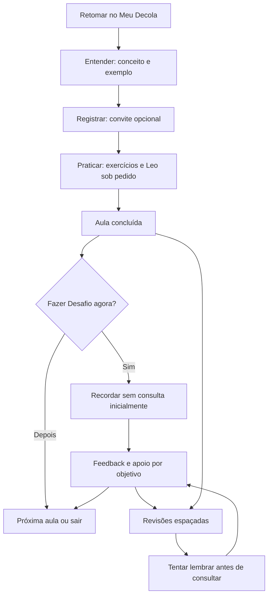

# Fluxo de aprendizagem e proposta de interface

**Especificação textual, não protótipo funcional.** Todos os textos de interface abaixo são propostas editoriais.

## 1. Jornada completa

| Momento | O aluno vê/faz | Saída livre e estado preservado |
| --- | --- | --- |
| Entrar no Meu Decola | Retoma aula/questão; vê convite discreto de revisão quando houver | Pode escolher outra aula; agenda não bloqueia navegação |
| Entender | Objetivo da aula, explicação breve e exemplo | Pausa/retoma sem abrir chat automaticamente |
| Registrar | Convite “Explique com suas palavras”; escolhe papel, digital pessoal ou combinado | “Continuar sem registrar agora”; sem exigir texto, foto ou confirmação |
| Praticar | Resolve exercícios atuais, recebe feedback e segunda tentativa | Botão Leo continua na questão; tentativas e leitura preservadas |
| Concluir aula | Relatório atual e cartão “O que ficou na memória?” | “Começar desafio” ou “Deixar para depois”; conclusão da aula não depende disso |
| Recordar | Duas ou três perguntas inicialmente sem consulta | Dica, consulta autodeclarada, “Não lembro ainda” e pausa disponíveis |
| Rever a rodada | Feedback, solução e escolha de reforço de um objetivo | Retomar a aula, refazer variante ou ir à próxima |
| Encerrar | Próxima aula e próximas datas de revisão, quando agenda for implementada | Não exige avaliação positiva ou anotação; sem mensagens automáticas de IA |
| Retornar em outro dia | Revisão começa por lembrar/aplicar, depois permite conferência | Ao adiar, manter histórico e próxima oportunidade sem penalidade |

## 2. Localização das funções

**Na aula:** pequeno marcador dos quatro movimentos e convite de registro próximo ao conceito. O Desafio fica após o relatório; não substitui as questões atuais nem intercepta “Próxima aula”. O botão inline do Leo permanece no mesmo lugar.

**No Meu Decola:** preservar Retomar atividade, Aulas disponíveis e Seus atalhos. Futuramente acrescentar uma seção “Revisões” com o próximo objetivo, data e ação. Caderno em ferramentas pessoais, separado de matérias e da conversa. Não criar sexto/setimo destino principal no piloto por padrão; avaliar necessidade com estudantes.

**No progresso:** separar “Aula: concluída” de “Recordação: ainda não observada / com apoio / sem apoio nesta rodada”. Mostrar data e contexto de cada evidência; não renomear os acertos antigos como evidência de memória.

**No Leo original:** manter chat livre e desafios de fixação atuais. A nova conversa do Desafio deve ter contexto e histórico próprios, sem misturar perguntas de outra aula. Pedir ajuda não muda a nota do simulado ou consome tentativa de exercício de aula.

## 3. Caderno Decola — especificação visual

### Convite dentro da aula

Título: **“Registrar do seu jeito”**.
Texto: “Em uma frase, explique o que você entendeu. Use papel, seu aplicativo de notas ou os dois.”
Ações propostas: “Ver sugestões de registro”, “Continuar aula”. Não apresentar um campo obrigatório para liberar o conteúdo.

“Ver sugestões” expande, no fluxo da página, os quatro prompts da metodologia. Deve ser recolhível por botão e teclado, sem ocultar o botão de continuar. Pode mostrar “Hoje vou usar: papel / digital / combinado”, opção facultativa sem vantagem de pontuação. No primeiro piloto, não pedir o texto das notas.

### Editor integrado, somente fase posterior

Uma área pessoal com título da aula, rascunho, status de salvamento e ligação para voltar à origem. Prompts são sugestões, não formulário obrigatório. Não oferecer “Leo faz meu resumo” como ação principal; priorizar explicar, exemplificar e depois conferir. Análise de texto pelo Leo só por ação explícita, com aviso sobre envio e opção de não enviar.

Sem promessa de sincronização enquanto não houver infraestrutura aprovada. Em falha de armazenamento: aviso claro, texto mantido em memória e opção de copiar/exportar antes de sair. Nunca mostrar “Salvo” sem confirmação. Retenção, exclusão e exportação precisam ser definidas antes do editor.

## 4. Desafio da Memória — especificação visual

### Entrada

Cartão: **“Desafio da Memória · Porcentagem”**.
Texto: “Três perguntas rápidas para descobrir o que você consegue lembrar e usar. Tente primeiro sem consultar; se precisar, tudo bem pedir ajuda.”
Ações: **Começar desafio** / **Deixar para depois**.
Não usar “Prova final”, contagem regressiva ou “Você falhou”.

### Pergunta

Cabeçalho: **“Porcentagem · Recordar · Pergunta 1 de 3”**.
Enunciado em texto legível e campo curto ou resposta oral/papel com autocorreção posteriormente, conforme escopo aprovado. Ações: **Registrar resposta e seguir**, **Não lembro ainda**, **Pedir uma dica**, **Consultar minhas anotações**, **Salvar e sair** (somente quando persistência existir).

Campo de confiança opcional: “Tenho segurança / Tenho dúvida”. Confiança não substitui a resposta. Não impedir colar conteúdo; explicar que tentar lembrar primeiro torna o exercício mais útil. Sem monitorar abas ou detectar IA.

Consulta abre orientação: “Pode consultar. Vamos diferenciar esta resposta da tentativa sem ajuda para planejar uma boa revisão.” Não vasculhar o caderno nem exigir comprovação. Se o aluno responde em papel, aceitar “Vou conferir pela referência”; registrar como autocorreção, não correção automática.

### Feedback e reforço

Após a rodada inicial, mostrar por objetivo: o que demonstrou, o que revisar, explicação de referência e ação **Praticar este ponto**. Resolução não aparece na mesma tela antes da tentativa inicial, salvo quando o aluno encerra essa tentativa e solicita a explicação. Uma dica não pode entregar respostas de outros itens pendentes.

“Perguntar ao Leo” abre conversa dentro do Desafio, com fechamento que devolve foco e leitura. Nenhuma solicitação automática; resposta local deve estar identificada como referência da aula, sem IA. Se offline, as perguntas e feedback editorial continuam disponíveis; a explicação real informa indisponibilidade e preserva o estado.

## 5. Comportamento em celular e computador

| Aspecto | Proposta e critério |
| --- | --- |
| Celular | Uma coluna, pergunta por vez; sem editor e chat lado a lado; sem rolagem horizontal em 360/390 px |
| Computador | Área central de leitura; bloco de registro recolhível. Layout amplo pode acomodar caderno depois, sem ser necessário ao percurso |
| Menu | Reutilizar os seis destinos atuais; ações do Desafio pertencem ao contexto da aula |
| Teclado | Ordem de foco previsível; rótulos de campos; Escape fecha explicação/expansão antes de sair do contexto; retorno ao acionador |
| Feedback | Texto e ícone além de cor; avisos por região de status sem interromper fala a cada tecla |
| Continuidade | Registrar questão/etapa e rascunho em persistência futura própria; não sobrecarregar decola-navigation:v1 com texto ou desempenho |
| Pausa | Acesso constante a voltar/sair; nenhuma janela obrigatória de confirmação de anotação |
| Ajuda | Uma solicitação por vez; cancelamento seguro, proteção contra resposta tardia e opção de continuar localmente |

## 6. Estados que precisam de projeto explícito

- Primeira visita: explicar os quatro movimentos em uma frase, sem tutorial bloqueante.
- Aula já concluída antes do recurso: permitir começar o Desafio; não inventar histórico retroativo.
- Desafio adiado: aula continua concluída; evidência de memória continua não observada.
- Texto não compreendido pela correção: não classificar como erro conceitual automaticamente; pedir esclarecimento.
- Requisição excedente ou indisponível: preservar texto, contexto e tentativa; não reduzir instruções essenciais para caber no limite.
- Troca de aula durante resposta do Leo: cancelar sem aplicar resultado em outro contexto.
- Armazenamento bloqueado/corrompido: avisar sobre limite de persistência, não limpar os históricos atuais para resolver.
- Mudança de formato de caderno: não altera acesso, desempenho ou agenda por si só.

Essas telas são uma proposta de experiência. Nenhum botão, campo, agenda ou editor descrito aqui foi adicionado à aplicação nesta entrega.
